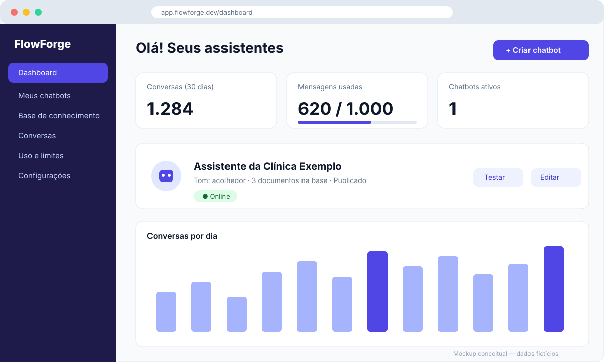
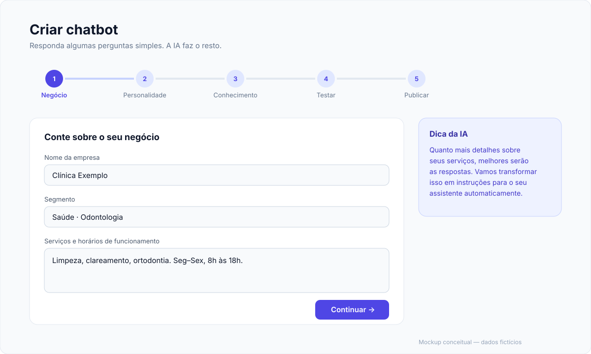
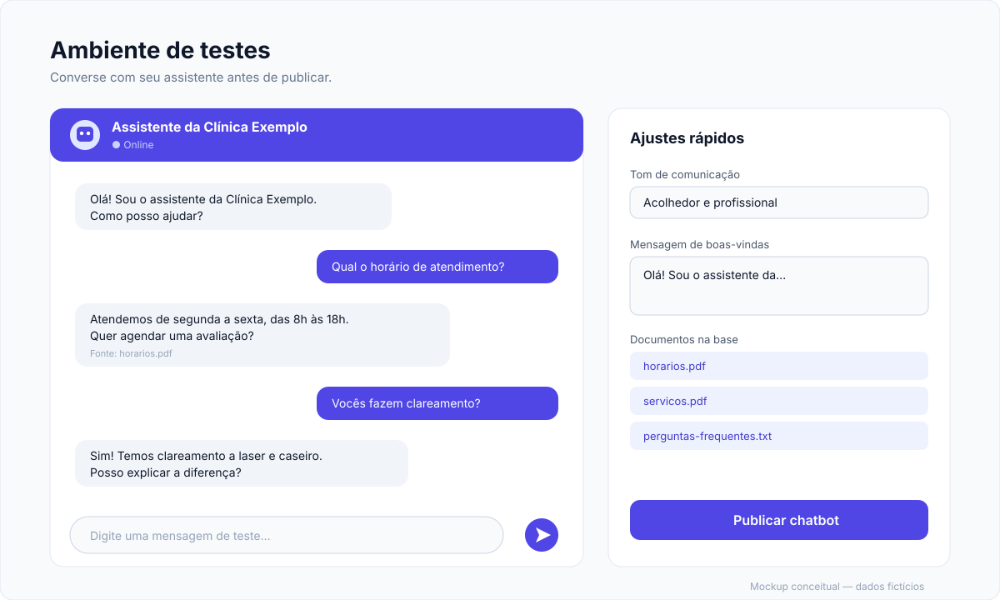
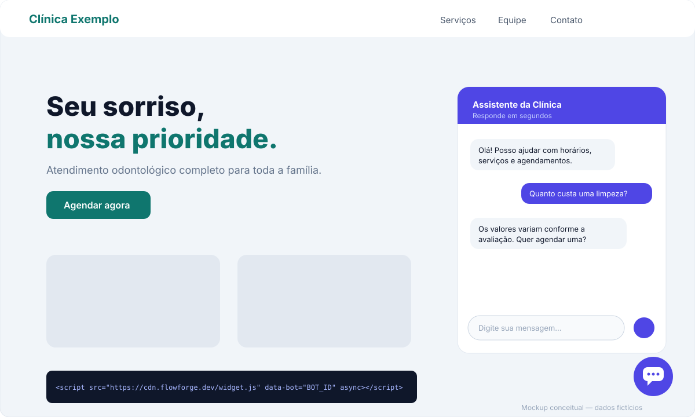

  

  
  
  
  
  

# FlowForge

> **Sua ideia. Sua inteligência. Sua automação.**

**FlowForge** é uma plataforma SaaS **no-code** para criar, personalizar e publicar chatbots com inteligência artificial — sem escrever uma linha de código.

A ideia central: **qualquer pessoa deve conseguir criar seu próprio chatbot sem precisar contratar alguém para isso.**

> 🚧 **Projeto em fase de planejamento.** Este repositório contém o escopo inicial, a arquitetura prevista e o roadmap. As imagens abaixo são **mockups conceituais** e não representam a interface final.

---

## 📌 Índice

- [O problema](#-o-problema)
- [A solução](#-a-solução)
- [Como vai funcionar](#-como-vai-funcionar)
- [Prévia do sistema](#-prévia-do-sistema-mockups)
- [Funcionalidades do MVP](#-funcionalidades-do-mvp)
- [Arquitetura e stack](#-arquitetura-e-stack)
- [Roadmap](#-roadmap)
- [Modelo de negócio](#-modelo-de-negócio)
- [Segurança e privacidade](#-segurança-e-privacidade)
- [Documentação](#-documentação)
- [Como contribuir](#-como-contribuir)

---

## 🎯 O problema

Pequenos negócios e profissionais autônomos querem automatizar o atendimento, mas esbarram em:

- Alto custo de contratar desenvolvedores ou especialistas em automação
- Ferramentas complexas (APIs, webhooks, integrações)
- Dificuldade para configurar modelos de IA
- Dependência de terceiros para qualquer alteração simples
- Falta de atendimento fora do horário comercial

## 💡 A solução

Um processo **guiado e simples**: o usuário descreve o negócio, envia documentos, testa o assistente e publica em um site com um trecho de código. A plataforma cuida da parte técnica.

**Para quem é:** clínicas, salões, restaurantes, lojas, academias, escolas, dentistas, psicólogos, advogados, consultores, personal trainers, designers e empreendedores em geral. Como público secundário: agências, freelancers e consultorias de tecnologia.

## 🧭 Como vai funcionar

1. Criar conta e acessar o painel
2. Clicar em **Criar chatbot**
3. Informar os dados do negócio
4. Configurar personalidade e regras de atendimento
5. Adicionar documentos e informações (base de conhecimento)
6. Testar o chatbot no próprio painel
7. Personalizar a aparência
8. Publicar com um snippet de código
9. Acompanhar conversas e uso

## 🖼️ Prévia do sistema (mockups)

### Dashboard

### Criação guiada (wizard)

### Ambiente de testes

### Widget incorporado em um site

## ✅ Funcionalidades do MVP

- [ ] Cadastro e autenticação
- [ ] Dashboard
- [ ] Criação e gerenciamento de chatbots
- [ ] Assistente de configuração guiada
- [ ] Personalização de comportamento e aparência
- [ ] Integração com provedor de IA (camada independente de provedor)
- [ ] Base de conhecimento com **RAG** (PDF, texto, perguntas e respostas)
- [ ] Ambiente de testes
- [ ] Widget incorporável em sites
- [ ] Histórico de conversas
- [ ] Controle básico de utilização

**Fora do MVP (versões futuras):** WhatsApp, CRM, agendamento, webhooks, handoff para humano, editor visual de fluxos, recursos para agências.

## 🏗️ Arquitetura e stack

| Tecnologia | Responsabilidade |
|---|---|
| React + TypeScript + Vite | Interface do usuário |
| Tailwind CSS | Estilização |
| Python + FastAPI | APIs do backend |
| PostgreSQL + SQLAlchemy | Banco relacional e ORM |
| Qdrant | Banco vetorial (RAG) |
| Redis | Cache e filas |
| Docker | Containerização |
| Pytest | Testes automatizados |

Detalhes em [`docs/ARQUITETURA.md`](docs/ARQUITETURA.md).

## 🗺️ Roadmap

| Fase | Foco |
|---|---|
| 1 — Fundação | Estrutura, backend/frontend, banco, autenticação, dashboard |
| 2 — Criação de chatbots | Wizard, configurações, personalização, gerenciamento |
| 3 — Inteligência artificial | LLM, base de conhecimento, RAG, ambiente de testes |
| 4 — Publicação | Widget, integração com sites, histórico de conversas |
| 5 — SaaS | Controle de uso, limites do plano gratuito, métricas, administração |
| 6 — Expansão | WhatsApp, editor visual, integrações, agências, planos comerciais |

Detalhes em [`docs/ROADMAP.md`](docs/ROADMAP.md).

## 💰 Modelo de negócio

Começa **gratuito** para validar a experiência e conquistar os primeiros usuários. Depois, assinaturas:

| Plano | Para quem |
|---|---|
| Gratuito | 1 chatbot, personalização básica, base limitada, mensagens limitadas |
| Starter | Pequenos negócios com uso regular |
| Pro | Empresas que dependem do atendimento automatizado |
| Business | Equipes, agências e necessidades complexas |

Limites e preços serão definidos considerando custos de infraestrutura e de uso dos modelos de IA.

## 🔒 Segurança e privacidade

Isolamento de dados por usuário, autenticação segura, proteção de chaves de API, validação de arquivos enviados, limites e proteção contra abuso, políticas de retenção/exclusão e adequação à **LGPD**. Mais em [`docs/SEGURANCA.md`](docs/SEGURANCA.md).

## 📚 Documentação

- [Escopo do projeto](docs/ESCOPO.md)
- [Arquitetura](docs/ARQUITETURA.md)
- [Roadmap](docs/ROADMAP.md)
- [Segurança e privacidade](docs/SEGURANCA.md)

## 🤝 Como contribuir

O projeto ainda está em fase inicial. Veja [`CONTRIBUTING.md`](CONTRIBUTING.md) para sugestões e fluxo de trabalho.

## 📄 Licença

Distribuído sob a licença MIT. Veja [`LICENSE`](LICENSE).

---

<b>Missão:</b> democratizar o acesso à inteligência artificial e permitir que qualquer pessoa tenha autonomia para criar seu próprio assistente virtual.

