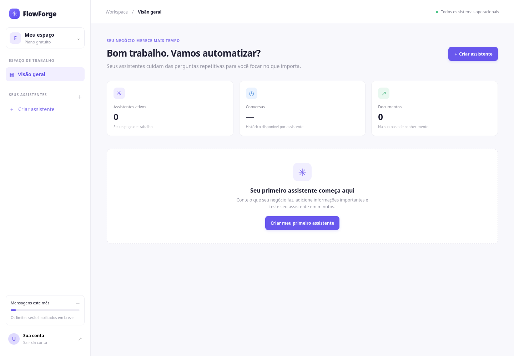

<p align="center">
  
</p>

<p align="center">
  <a href="https://github.com/victor-dar/flowforge/actions/workflows/ci.yml"></a>
  
  <a href="LICENSE"></a>
</p>

<p align="center">
  <strong>Crie assistentes de atendimento, ensine com seus documentos e publique no seu site.</strong>
</p>

<p align="center">
  <a href="#sobre-o-projeto">Sobre</a> ·
  <a href="#funcionalidades">Funcionalidades</a> ·
  <a href="#início-rápido">Início rápido</a> ·
  <a href="docs/GUIA_USUARIO.md">Guia do usuário</a> ·
  <a href="docs/API.md">API</a>
</p>

## Sobre o projeto

FlowForge é um projeto open source em estágio de MVP para configurar chatbots de atendimento com informações de um negócio e incorporá-los em sites. O repositório contém um painel web em React e TypeScript, uma API em FastAPI e um widget JavaScript.

> **Estado:** funcional para desenvolvimento e demonstração; ainda não recomendado como serviço SaaS de produção. A busca de documentos é lexical, o armazenamento padrão é SQLite e recursos operacionais e de privacidade ainda precisam evoluir.

## Funcionalidades

- Cadastro, login e gerenciamento isolado de assistentes por usuário.
- Configuração de nome, empresa, instruções, mensagem inicial e cor.
- Upload de documentos PDF, TXT, MD e CSV, com limite padrão de 5 MB.
- Teste de conversa no painel e histórico acessível pela API.
- Widget incorporável em sites por meio de um snippet JavaScript.
- Integração opcional com uma API compatível com OpenAI.
- Limites de requisição para autenticação e chat público.

Sem chave de IA, o chat responde com trechos encontrados nos documentos ou informa que não encontrou contexto suficiente. A recuperação atual usa correspondência lexical; não usa embeddings ou busca vetorial.

## Interface

<p align="center">
  
</p>
<p align="center">
  <sub>Painel em estado inicial, sem dados de usuário.</sub>
</p>

<details>
  <summary>Ver tela de acesso</summary>
  <p align="center">
    
  </p>
</details>

## Início rápido

### Com Docker Compose

Requer Docker Engine e Docker Compose:

```bash
docker compose up --build
```

Após a inicialização:

| Serviço | Endereço |
|---|---|
| Painel | <http://localhost:5173> |
| API | <http://localhost:8000> |
| Documentação interativa | <http://localhost:8000/docs> |
| Verificação de saúde | <http://localhost:8000/health> |

O Compose usa SQLite e persiste os dados no volume `flowforge_data`. Para usar um provedor de IA, configure `OPENAI_API_KEY` no ambiente antes de iniciar os serviços.

### Execução local

Requer Python 3.11 ou superior, Node.js 22 e npm.

**1. Inicie a API:**

```bash
cd backend
python -m venv .venv
source .venv/bin/activate  # Windows: .venv\Scripts\activate
pip install -r requirements.txt
cp .env.example .env
uvicorn app.main:app --reload
```

**2. Em outro terminal, inicie o painel:**

```bash
cd frontend
npm ci
npm run dev
```

O painel usa `http://localhost:8000` como URL padrão da API. Para apontar a outro endereço, defina `VITE_API_URL` antes de iniciar o Vite ou gerar o build.

## Configuração

A API lê configurações do ambiente e de `backend/.env`. As opções disponíveis e seus valores padrão estão em [`backend/.env.example`](backend/.env.example).

Além do limite de upload (`MAX_DOCUMENT_BYTES`, padrão de 5 MB), o texto extraído tem limite de `MAX_DOCUMENT_CHARACTERS` (padrão de 500.000 caracteres). Arquivos que ultrapassarem qualquer limite são rejeitados sem salvar conteúdo parcial.

Para produção, use `APP_ENV=production`, configure uma `SECRET_KEY` aleatória e exclusiva com pelo menos 32 caracteres, defina origens explícitas em `CORS_ORIGINS` e termine TLS em um proxy/ingress confiável. Não use a chave padrão do Compose. Consulte [Segurança e privacidade](docs/SEGURANCA.md) antes de expor a aplicação.

## Testes

```bash
# Backend
cd backend
pip install -r requirements.txt
pytest -q
```

Em outro terminal, a partir da raiz do repositório:

```bash
cd frontend
npm ci
npm test
npm run build
```

O CI também executa testes do backend com Python 3.12 e build do frontend com Node.js 22 em pushes e pull requests.

## Limitações atuais

- Busca lexical simples; sem embeddings, OCR ou banco vetorial.
- SQLite como banco padrão; carga concorrente e operação de produção não foram validadas.
- Sem confirmação de e-mail, recuperação de senha, cobrança ou métricas de uso completas.
- O widget ainda não restringe domínios permitidos por chatbot.
- Políticas de retenção, exportação e exclusão de dados ainda precisam ser definidas.

Essas limitações e os próximos passos estão detalhados em [Escopo](docs/ESCOPO.md) e [Roadmap](docs/ROADMAP.md).

## Documentação

| Documento | Conteúdo |
|---|---|
| [Guia do usuário](docs/GUIA_USUARIO.md) | Cadastro, configuração, documentos, testes e publicação |
| [Referência da API](docs/API.md) | Endpoints, autenticação e exemplos |
| [Arquitetura](docs/ARQUITETURA.md) | Componentes e fluxos atualmente implementados |
| [Escopo](docs/ESCOPO.md) | Estado das funcionalidades e objetivos do MVP |
| [Roadmap](docs/ROADMAP.md) | Evoluções planejadas |
| [Segurança e privacidade](docs/SEGURANCA.md) | Controles, configuração e lacunas conhecidas |
| [Contribuição](CONTRIBUTING.md) | Ambiente, validações e fluxo de pull request |

## Contribuições

Relatos, sugestões e pull requests são bem-vindos. Para mudanças maiores, abra uma issue para discutir a proposta antes de começar. Consulte [`CONTRIBUTING.md`](CONTRIBUTING.md) para instruções.

## Licença

Distribuído sob a licença [MIT](LICENSE).
