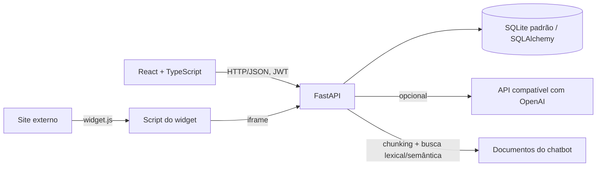

# Arquitetura do FlowForge

Este documento descreve o código implementado no repositório hoje. Componentes planejados para versões futuras aparecem como evolução, não como parte do runtime atual.

## Visão geral




## Componentes implementados

| Componente | Localização | Responsabilidade |
|---|---|---|
| Painel | `frontend/src/` | Autenticação, gerenciamento de assistentes, configuração, upload, teste e snippet do widget |
| API | `backend/app/main.py` | Rotas HTTP, autenticação/autorização, persistência, upload e chat |
| Modelos | `backend/app/models.py` | Usuários, chatbots, documentos, conversas, mensagens e buckets de rate limit |
| Provedor de IA e busca | `backend/app/ai.py` | Chunking, embeddings opcionais, recuperação híbrida e chamada ao endpoint compatível |
| Domínios do widget | `backend/app/models.py`, `backend/app/main.py` | Allowlist por chatbot aplicada às rotas públicas |
| Migrações | `backend/alembic/` | Evolução versionada do esquema SQLite/PostgreSQL |
| Widget | `backend/app/widget.js`, `backend/app/widget_page.py` | Botão incorporável e interface de conversa em iframe |
| Banco | SQLAlchemy | SQLite por padrão; URL configurável |

## Fluxo de autenticação e gerenciamento

1. O painel envia credenciais à API.
2. A senha é derivada com PBKDF2-HMAC-SHA256; a API retorna um JWT Bearer.
3. Rotas privadas validam o token e associam as operações ao usuário autenticado.
4. As consultas de chatbot verificam a propriedade antes de retornar ou alterar dados.

## Fluxo de mensagem

1. O painel ou widget envia `message`, `visitor_id` e, em mensagens seguintes, `conversation_id`.
2. A API valida o chatbot e confirma que uma conversa fornecida pertence àquele chatbot e visitante.
3. Limites por IP e chatbot são contabilizados no banco.
4. A API procura trechos lexicalmente relevantes e, com embeddings configurados, compara os vetores persistidos dos chunks.
5. Recupera até seis mensagens anteriores da conversa e envia instruções, contexto recuperado, histórico limitado e pergunta ao modelo configurado.
6. Sem `OPENAI_API_KEY`, responde com o contexto recuperado ou uma saudação/fallback apropriado.
6. Mensagem e resposta são persistidas e a resposta retorna ao cliente.

O histórico é limitado em quantidade e tamanho. Embeddings são opcionais e persistidos por chunk; sem provedor válido, o sistema retorna ao fallback lexical.

## Fluxo de documentos

1. Um usuário autenticado envia PDF, TXT, MD ou CSV para um chatbot que possui.
2. A API limita tamanho e caracteres, extrai texto (PDF via `pypdf`; demais formatos como UTF-8) e rejeita conteúdo vazio.
3. O texto é dividido em chunks com sobreposição e persistido junto com embeddings opcionais.
4. Na solicitação de chat, a busca combina ranking lexical e similaridade dos embeddings persistidos.

Não há fila/worker, OCR ou banco vetorial dedicado nesta versão.

## Persistência e consistência

SQLAlchemy é a camada de persistência. A configuração padrão utiliza SQLite local; Docker Compose persiste o arquivo em volume. PostgreSQL é suportado com Psycopg e pode ser iniciado pelo `docker-compose.postgres.yml`. Alembic fornece migrações iniciais; o lifespan ainda pode criar tabelas ausentes durante desenvolvimento com `Base.metadata.create_all`, mas produção deve executar Alembic.

SQLite/PostgreSQL são os dialetos explicitamente suportados pelo rate limiter. A URL pode ser alterada, mas outros dialetos não são compatíveis com esse recurso no código atual.

## Widget incorporável

O snippet carrega `widget.js` com `data-bot-id`. O script cria um botão e um iframe apontando para a página do widget servida pela API. A página consulta as rotas públicas do chatbot.

Exemplo:

```html
<script
  src="https://api.exemplo.com/widget.js"
  data-bot-id="123"
  defer
></script>
```

Substitua domínio e ID pelos valores do seu ambiente. As requisições públicas podem ser restritas por uma lista de domínios configurada no chatbot. O script solicita ao backend uma capacidade curta assinada após validar o `Referer`; o parâmetro de domínio da página não é suficiente por si só. CORS continua sendo uma proteção separada.

## Implantação

Docker Compose oferece API e frontend e um volume SQLite para desenvolvimento/demonstração. Para produção, são necessários, no mínimo, planejamento de banco, migrações, segredo e CORS de produção, proxy/HTTPS, backups, logs/monitoramento e política de retenção. PostgreSQL, filas, cache e busca vetorial permanecem opções de evolução, não dependências atuais.
