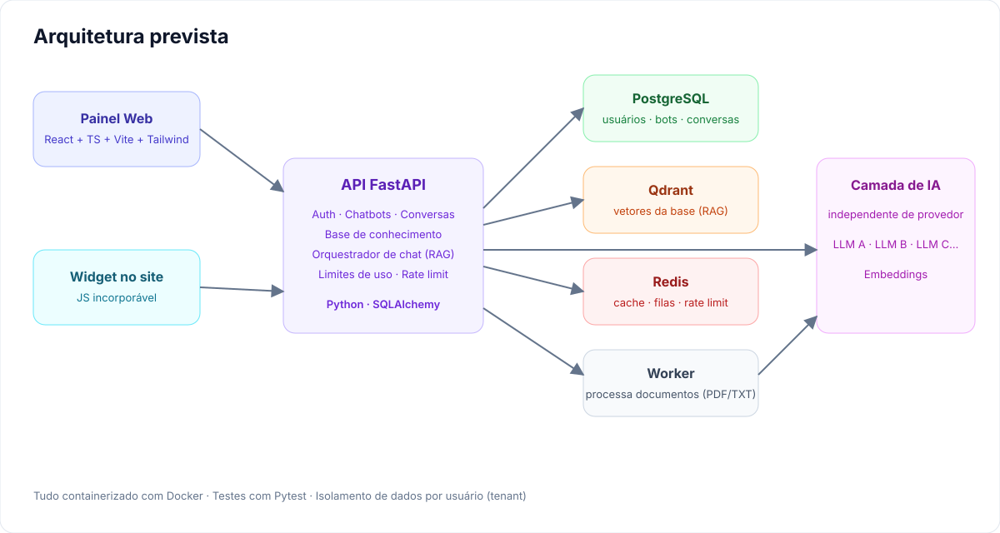

# Arquitetura — FlowForge

> Visão inicial. Sujeita a revisão conforme o projeto avança.



## Componentes

| Componente | Tecnologia | Papel |
|---|---|---|
| Painel web | React, TypeScript, Vite, Tailwind | Dashboard, wizard, testes, histórico |
| Widget | JavaScript incorporável | Chat exibido no site do cliente |
| API | Python, FastAPI | Autenticação, chatbots, conversas, base de conhecimento, orquestração |
| Banco relacional | PostgreSQL + SQLAlchemy | Usuários, chatbots, configurações, conversas, uso |
| Banco vetorial | Qdrant | Embeddings dos documentos (RAG) |
| Cache e filas | Redis | Cache, filas de processamento, rate limit |
| Worker | Python | Processamento assíncrono de documentos |
| Camada de IA | Interface própria | Abstrai provedores de LLM e embeddings |
| Infra | Docker | Containerização e ambiente local |
| Testes | Pytest | Testes automatizados do backend |

## Fluxo de uma mensagem (widget → resposta)

1. Visitante envia mensagem pelo widget
2. API valida o bot, a origem e os limites de uso
3. Orquestrador busca trechos relevantes no Qdrant (somente da base daquele bot)
4. Monta o prompt: instruções do bot + contexto recuperado + histórico da sessão
5. Chama o provedor de IA pela camada independente
6. Salva a conversa no PostgreSQL e contabiliza o uso
7. Retorna a resposta ao widget

## Fluxo de ingestão de documentos

1. Usuário envia PDF/TXT no painel
2. API valida tipo, tamanho e propriedade
3. Job entra na fila (Redis)
4. Worker extrai texto, divide em trechos, gera embeddings
5. Vetores são gravados no Qdrant com identificação do bot/usuário
6. Status do documento é atualizado no painel

## Camada independente de provedores de IA

Interface única (ex.: `generate()` e `embed()`), com um adaptador por provedor. Trocar ou adicionar modelos não exige alterar o restante da aplicação.

## Multi-tenancy

Todo dado é associado ao usuário proprietário. Consultas relacionais e vetoriais sempre filtradas por proprietário/bot. Testes automatizados verificam o isolamento.

## Estrutura de pastas sugerida (para quando o código começar)

```
flowforge/
├── apps/
│   ├── web/          # React + TS + Vite
│   ├── api/          # FastAPI
│   └── widget/       # Widget incorporável
├── packages/
│   └── ai-providers/ # Camada independente de provedores
├── infra/            # Docker, compose
├── docs/
└── assets/
```
